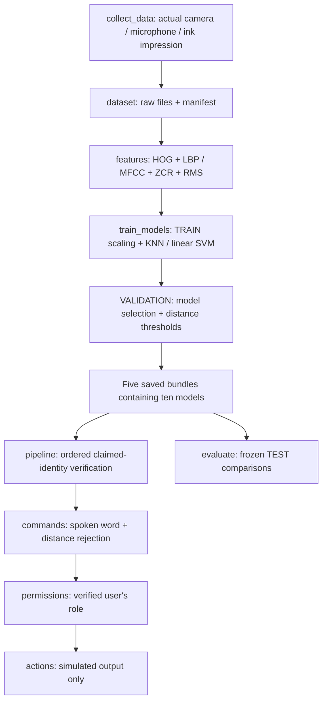

# Hierarchical Multimodal Biometric Verification

An introductory Python machine learning project for a 3–4 student team. A user claims an identity, passes face, voice, early-fusion, and fingerprint verification, and then requests a spoken simulated action. Authorization uses the verified user's configured role.

**Current state:** implementation and automated checks are available. The repository contains **zero real biometric samples and zero trained biometric models**. Real training, measured accuracy, confusion matrices, and a successful live demo are blocked until participants collect the custom dataset. See [results/STATUS.md](results/STATUS.md) for actual verification evidence and the completion checklist. No performance numbers have been invented.

## Scope and assignment requirements

Only KNN with `n_neighbors=3` and SVM with `kernel="linear"` are trained. Image features are HOG and a normalized uniform LBP histogram. Audio features are MFCC, ZCR, and RMS. There is no deep learning, pretrained biometric model, speech-to-text service, web application, cloud authentication, or real protected-device control.

The four bonus implementations share the same pipeline:

| Bonus | Implementation | Current evidence |
|---|---|---|
| Spoken commands | Separate word classifiers; same audio features used for speaker verification; unknown-distance gate | Feature and branching tests pass; trained recognition blocked by missing recordings |
| Live verification | OpenCV guide/capture, sounddevice recording, new fingerprint import/capture | Dependencies checked; camera unavailable; microphone devices/settings found, recording untested |
| Custom dataset | Session collector, manifest generation, duplicate/path/split/count checks | Integrity tests pass; real collection pending |
| Fingerprint verification | HOG/LBP, both algorithms, identity template and distance gate, mandatory final biometric stage | Feature and rejection tests pass; genuine impressions and real models pending |

## Install and run

Tested with Python 3.13.5 on Windows. Use a virtual environment. The development environment reuses existing scientific packages through `--system-site-packages`; a new installation can use a fully isolated environment:

```powershell
git clone https://github.com/renadborham123/hierarchical-multimodal-biometric-verification.git
cd hierarchical-multimodal-biometric-verification
python -m venv .venv
.\.venv\Scripts\python.exe -m pip install -r requirements.txt
.\.venv\Scripts\python.exe collect_data.py --check-hardware
.\.venv\Scripts\python.exe -m unittest discover -s tests -v
.\.venv\Scripts\python.exe main.py
```

The CLI provides exactly these choices: collect, validate, train, evaluate, face only, voice only, fusion only, fingerprint only, full live demo, exit. Options 5–8 report verification decisions without recognizing or executing commands. Option 9 is the protected command workflow. Each attempt is a fresh session; LOGOUT ends that verified attempt and returns to the menu.

All application data paths are based on `config.py`'s project root, independent of the terminal's working directory. `CAMERA_INDEX`, role assignments, and the configured user IDs are editable there. For three participants, remove one user and choose the desired roles before collection. Changing the user list or feature settings requires retraining. Roles can change without retraining when user IDs stay the same.

## Collect the real team dataset

Every configured user must complete 10 sessions. Each session contains **all four** words, each with a corresponding face image, and one separately acquired fingerprint impression. Every user must say UNLOCK and REPORT even if their role cannot execute those commands. Word recognition, speaker identity, and permissions are separate tasks.

| Per user | TRAIN: sessions 01–06 | VALIDATION: 07–08 | TEST: 09–10 | Total |
|---|---:|---:|---:|---:|
| Matched face/audio pairs | 24 | 8 | 8 | 40 |
| STATUS repetitions | 6 | 2 | 2 | 10 |
| REPORT repetitions | 6 | 2 | 2 | 10 |
| UNLOCK repetitions | 6 | 2 | 2 | 10 |
| LOGOUT repetitions | 6 | 2 | 2 | 10 |
| Distinct fingerprint impressions | 6 | 2 | 2 | 10 |

Four users require 160 face images, 160 recordings, and 40 genuine impressions. Three users require 120 images, 120 recordings, and 30 impressions. Collect sessions at different times where practical. Use the same microphone/camera/background arrangements across participants so the models cannot identify people from the equipment or location.

For each session:

1. Keep the same participant in front of the camera and microphone for the entire session.
2. Run the command below. For each prompted word, press Enter, align the face inside the green center guide, and press Space. Then speak the prompted word once during the two-second recording. Escape cancels the camera preview.
3. Provide a new ink impression, using the webcam or an external phone/scanner image. Existing complete samples are preserved on resume. If interrupted between saving a pair's two files, inspect that incomplete pair and remove those incomplete files manually before retrying.
4. Repeat for sessions 01–10 and every user. Never move individual samples between splits.

```powershell
.\.venv\Scripts\python.exe collect_data.py --user user_01 --session 1
# Or import a newly acquired, centered ink impression from outside data/raw:
.\.venv\Scripts\python.exe collect_data.py --user user_01 --session 1 --fingerprint "C:\new-impressions\user01-session01.jpg"
.\.venv\Scripts\python.exe dataset.py --partial
.\.venv\Scripts\python.exe dataset.py
```

### Fingerprint collection with a phone or scanner

Use a washable ink pad and plain white paper. Lightly coat the **same finger** for each session and press once on the paper without sliding. Make a fresh impression for each session; label the paper with user and session outside the image crop. Photograph directly overhead under even light with no glare, or scan at a consistent setting (for example, 300 dpi). Confirm ridge texture is visible. A photograph of skin on a fingertip is not an ink impression and is not acceptable.

Center the impression and keep its orientation, scale, lighting, and margins consistent. The center 65% square of each image is the fingerprint feature area. The center 60% square is used for face images. The full captured image is saved; the same fixed crop is applied once during both training and inference. Avoid tightly cropping a phone image twice: leave the guide margins around its useful ridge area. Webcam preview displays the exact crop guide.

Use a **new acquisition** for the live demo. Enrollment paths and byte-identical enrolled files are rejected for live file imports. File checks cannot prove a photograph is a new physical impression, detect all re-encoded copies, or establish identity; participants must maintain truthful acquisition records. No liveness or spoof detector is implemented.

### Manifest and checks

```text
data/
  manifest.csv
  raw/user_01/session_01/
    STATUS_face.jpg       STATUS_voice.wav
    REPORT_face.jpg       REPORT_voice.wav
    UNLOCK_face.jpg       UNLOCK_voice.wav
    LOGOUT_face.jpg       LOGOUT_voice.wav
    fingerprint.jpg
```

The CSV columns are `user_id, session_id, command, trial_id, face_path, voice_path, fingerprint_path, split`. Paths are relative to `data/`. `trial_id` equals the two-digit session number; each user repeats each command once per session. The same fingerprint path appears in the session's four rows, intentionally. Training deduplicates those references so fingerprint models see six training impressions per user, rather than 24 repeated examples.

Collection rebuilds the manifest even after an interrupted session. `dataset.py --rebuild` also regenerates it after manual inspection/import into the expected folders. Rebuilding uses the configured session policy. Validate any supplied manifest before rebuilding if you want to inspect its original split assignments.

Validation checks required columns, users, commands, trial IDs, expected ownership paths, all required sessions/commands, missing files, duplicate rows, duplicate file bytes, shared files, path escape/symlinks, and sessions crossing splits. Counts of pairs refer to manifest rows; missing files are listed separately. Fingerprint counts count distinct existing paths. Media decoding, silence, contrast, and numeric feature validity are additionally checked during extraction/training. Path metadata can detect mislabeled pair paths; it cannot establish that the two humans in correctly named files are actually the same person.

## Architecture and module contracts



| Module | Input | Responsibility / output | Main callers |
|---|---|---|---|
| `config.py` | Editable user/feature/path constants | Roles, commands, paths, session split | All application modules |
| `collect_data.py` | User/session; actual devices or new ink image | Matched raw samples and manifest; availability report | CLI; live pipeline |
| `dataset.py` | Manifest and files | Rows, integrity report/counts; dataset signature | Collector, trainer, evaluator, CLI |
| `features.py` | Image/path, audio/path, or two vectors plus scalers | Face 4366, audio 30, fingerprint 8110, fusion 4396 features | Collector, training, pipeline, individual demos |
| `train_models.py` | Complete valid manifest | Ten fitted estimators, TRAIN scalers/templates, validation selection/thresholds | CLI; direct script |
| `verification.py` | Feature vector and claimed user | Accepted, predicted user, claimed user, distance, threshold, reason | Pipeline, CLI, evaluator |
| `commands.py` | The already extracted voice vector | Accepted word or UNKNOWN, distance, threshold, reason | Pipeline only in production |
| `permissions.py` | Verified user ID and recognized word | Configured role and Boolean permission | Pipeline |
| `actions.py` | Authorized recognized word | Printed simulated response and session-end flag | Pipeline only |
| `pipeline.py` | Claimed user; live inputs or explicit offline samples | Ordered decisions, identity, command, role, permission, action/rejection | CLI; evaluator |
| `evaluate.py` | Frozen artifacts and real TEST samples | CSV tables, PNG matrices, trial log, setup JSON; never actions | Trainer, CLI, direct script |
| `main.py` | Menu choices and user input | Calls the appropriate module and prints results | Student running the application |
| `tests/` | Diagnostic numbers/patterns and explicit branch doubles | Automated software checks, not biometric measurements | `unittest` |

## Exact protected sequence

1. Select claimed identity.
2. Capture face; extract fixed-crop HOG + LBP; verify the claim.
3. Record **one** spoken word; extract its 30 audio features **once**; verify the speaker claim.
4. Reuse face and voice vectors; normalize each with saved TRAIN scalers; concatenate; verify with a separately trained fusion classifier.
5. Request a **new** fingerprint impression only after those checks pass; extract HOG + LBP; verify the claim.
6. Reuse the identical voice feature object for the separate word classifier and command distance gate.
7. Resolve the now-verified claimed user's role; check that role's permissions.
8. Execute a simulated action only when all gates and authorization pass. Print all decisions. Any failure ends the attempt immediately; later stages are marked NOT RUN.

The individual demos have no action path. Supplying samples to `run_pipeline` always creates an offline dry run; even a fully authorized offline trial never calls `execute_command`.

| Role | STATUS | REPORT | UNLOCK | LOGOUT |
|---|---|---|---|---|
| Admin (`user_01`) | Allow | Allow | Allow | Allow |
| Employee (`user_02`, `user_03`) | Allow | Allow | Deny | Allow |
| Guest (`user_04`) | Allow | Deny | Deny | Allow |

## Features, fitting, selection, and rejection

Images are center-cropped, converted to grayscale, resized to 96×96 for face or 128×128 for fingerprint, and described using HOG (9 orientations, 8×8 cells, 2×2 blocks) plus uniform LBP (`P=8`, `R=1`, 10 normalized bins). Blank/invalid images reject. These simple checks do not establish whether a valid-looking image contains the intended biometric.

Audio is mono, resampled to 16 kHz, truncated/padded to two seconds, and rejected if empty, nonfinite, shorter than 0.25 seconds, outside normalized float range, or below RMS 0.005. Speak promptly after the recording prompt. Features use 512-sample frames and 160-sample hops: 13 MFCC means, 13 standard deviations, ZCR mean/std, RMS mean/std. Padding, crop, scaling, and extraction are identical during training and inference.

Fit StandardScaler on TRAIN only. Fit one KNN and one linear SVM for each task; labels are identity for four tasks and word for the command task. Select each task's model by higher validation macro F1, then accuracy; an exact tie selects KNN. TEST is excluded from fitting, selection, and threshold tuning.

Early fusion concatenates the **separately standardized features**, not predictions. It uses the face and voice TRAIN scalers, and no additional fusion scaler. Separately scaling dimensions does not balance modality lengths: 4366 face dimensions may dominate 30 voice dimensions. Fusion is not guaranteed to improve results.

For every identity task, compute one mean normalized TRAIN feature template per user. A claim is accepted only when prediction equals claim **and** Euclidean distance to that claim's template is at most the saved threshold. Calibration enumerates validation samples with the genuine identity and every wrong enrolled identity, keeping the biometric sample unchanged. Candidate thresholds are zero and observed validation distances. Minimize `(FAR + FRR) / 2`; ties prefer lower FAR, then the smaller threshold. This balances rejections and false accepts without silently choosing an always-accept threshold.

Commands use separate word templates/scalers/models and the same validation calibration method with true/wrong known word labels. At inference, compare to the **predicted word** template. A failing distance check returns UNKNOWN. Wrong-known-word trials are only a proxy: there are no real unknown-word recordings in the required collection, so out-of-vocabulary FAR is not measured or guaranteed. Collect independent unknown-word probes for an honest later investigation; do not tune on TEST.

Each of the five `models/<task>.joblib` bundles stores both named estimators, selected name, scalers, templates, threshold, feature settings, user list, label mapping, validation metrics, and data signature. Missing, corrupt, inconsistent, or unfitted artifacts reject. Load only bundles generated locally by this project; joblib files are executable Python serialization, not an interchange format for untrusted downloads.

## Train, evaluate, and compare

Once every participant's dataset passes validation:

```powershell
.\.venv\Scripts\python.exe dataset.py
.\.venv\Scripts\python.exe train_models.py
# Training also evaluates the frozen models. Repeat evaluation without fitting:
.\.venv\Scripts\python.exe evaluate.py
# One real held-out, no-action trial (wrong identity claims are also allowed):
.\.venv\Scripts\python.exe evaluate.py --trial-user user_01 --session 9 --command STATUS --claim user_02
```

Evaluation first verifies the dataset signature matches the saved experiment. It reports accuracy, macro precision, macro recall, macro F1, and confusion matrices for both algorithms for all five tasks. Selected identity verifiers additionally report TP/FN/FP/TN, binary accuracy/precision/recall/F1, FAR, and FRR. `FAR = FP/(FP+TN)` and `FRR = FN/(FN+TP)`. An undefined denominator becomes a blank CSV field / JSON null, not a fabricated zero.

The hierarchical test uses each matched TEST row and every enrolled identity claim through the actual extraction/verifier/command/permission modules. Its binary acceptance means **all four biometric gates passed**. Command and permission results are recorded separately, because denying an Employee's UNLOCK is correct authorization rather than biometric false rejection. One session's genuine fingerprint is reused across its four command trials and every claim; those trials are correlated and are explicitly described in `test_setup.json`.

| Task | KNN model | SVM model | TEST comparison now |
|---|---|---|---|
| Face identity | `face_knn` | `face_svm` | BLOCKED: no real dataset |
| Voice identity | `voice_knn` | `voice_svm` | BLOCKED: no real dataset |
| Early fusion identity | `fusion_knn` | `fusion_svm` | BLOCKED: no real dataset |
| Fingerprint identity | `fingerprint_knn` | `fingerprint_svm` | BLOCKED: no real dataset |
| Spoken word | `command_knn` | `command_svm` | BLOCKED: no real dataset |

Real runs generate these files; none contain placeholder measurements:

- `results/training_summary.json`: validation choices and threshold evidence.
- `results/classification_metrics.csv`: ten TEST model comparisons.
- `results/verification_metrics.csv`: four selected modalities and hierarchical comparison.
- `results/confusion_matrices/`: ten classification matrices and five verification matrices.
- `results/pipeline_trials.csv`: per-claim biometric/word/permission outcomes.
- `results/test_setup.json`: trial definitions, counts, fingerprint reuse, limits.

## Example student demo

After real collection/training, run `main.py` and choose 9. Claim `user_01`, capture a live face, say UNLOCK once, and provide a new genuine ink impression when requested. If all real verifiers and word recognition accept, Admin sees `Simulated protected access unlocked`. Repeat with `user_02`: even when every biometric accepts and UNLOCK is recognized, authorization denies it. Poor inputs or a failed model gate reject earlier. These are expected flows, not claims that the examples have succeeded on real people in this environment.

## Testing and limits

Run `python -m unittest discover -s tests -v` through the virtual environment. The suite covers image/audio dimensions and preprocessing, silence/invalid data, separate fusion normalization, threshold math, missing/corrupt artifacts, manifest identity/split/duplicate/path checks, all required permission examples, every early-stop branch, unknown commands, reuse of one recording/vector, and offline no-action behavior. Pipeline doubles test control flow only. Checkerboards, tones, numeric arrays, and temporary marker bytes are diagnostic test fixtures; they are not saved as a participant dataset or used to report biometric accuracy.

The actual test run and hardware probe are in `results/STATUS.md`. Training/evaluation currently stop with a clear incomplete-dataset error. There are no fitted biometric artifacts or genuine TEST results yet. Real webcam capture is blocked because the camera probe returned unavailable. Microphone enumeration/settings succeeded, but live recording and a complete human demo were not tested.

This is a small educational system. Fixed crops require careful positioning. HOG/LBP fingerprint features are sensitive to rotation, pressure, lighting, and crop and do not perform minutiae matching. There is no liveness detection. Distance thresholds cannot guarantee rejection of unknown people or unknown words. Known-user impostor trials do not measure attacks by unseen people. Accuracy can be poor; report it unchanged. Do not call this a production biometric matcher.

## Official API references

- [scikit-image HOG and LBP](https://scikit-image.org/docs/stable/api/skimage.feature.html)
- [librosa MFCC/ZCR/RMS features](https://librosa.org/doc/0.11.0/feature.html)
- [scikit-learn KNeighborsClassifier](https://scikit-learn.org/stable/modules/generated/sklearn.neighbors.KNeighborsClassifier.html)
- [scikit-learn linear SVC](https://scikit-learn.org/stable/modules/generated/sklearn.svm.SVC.html)
